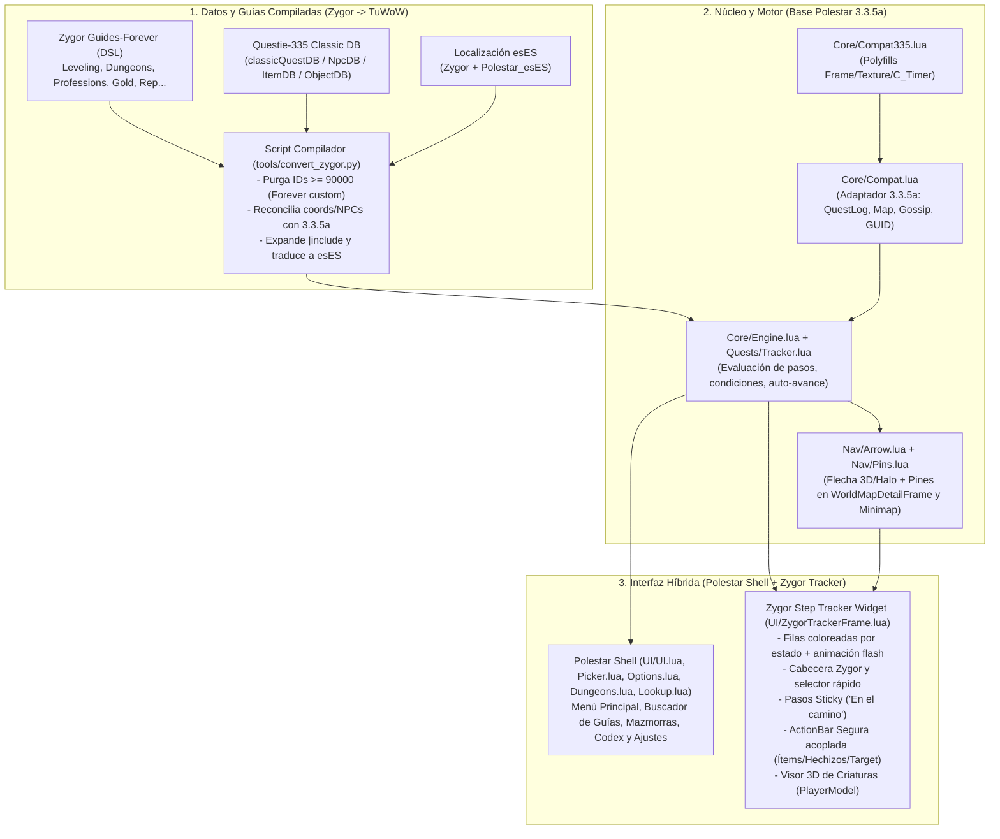

# Plan de Acción: `TuWoW_Leveling` (Híbrido Polestar UI + Guías y Widget de Zygor para TuWoW 3.3.5a)

> [!IMPORTANT]
> **Objetivo del Proyecto:** Crear el addon **`TuWoW_Leveling`** en [`c:/TuWoW/TuWoW-Client/Interface/AddOns/TuWoW_Leveling`](file:///c:/TuWoW/TuWoW-Client/Interface/AddOns/TuWoW_Leveling) para el cliente **TuWoW (`Interface: 30300` con ForeverUI)**, combinando:
> 1. **Shell e Interfaz Principal de Polestar** (Menú principal con pestañas, Selector de Guías, Buscador/Codex, Mazmorras, Talentos, Rares y Opciones).
> 2. **Widget Flotante de Seguimiento de Pasos Estilo Zygor** (Barras de objetivos coloreadas por progreso, animaciones de completado, barra de cabecera y navegación compacta, pasos *sticky*, **ActionBar acoplada** para objetos/hechizos/target y **Visor 3D de Criaturas**).
> 3. **Catálogo Completo de Guías 1-60 de Zygor depurado para TuWoW** (Purga automatizada de misiones/NPCs/ítems exclusivos de *WoW Forever* y reconciliación contra la base de datos Classic 3.3.5a de [`Questie-335`](file:///c:/TuWoW/TuWoW-Client/Interface/AddOns/Questie-335)).

---

## 1. Diagnóstico Técnico de los Addons Base y del Cliente TuWoW

### 1.1. Diferencias de API: Cliente WoW Forever (`106000`) vs. TuWoW (`30300`)
El cliente de **WoW Forever** corre sobre un motor moderno (`1.60.1`) con namespaces `C_*` y `BackdropTemplate`, mientras que **TuWoW** utiliza el motor **WotLK 3.3.5a (`30300`)** en Lua 5.1 junto con el addon del servidor [`ServerSystems`](file:///c:/TuWoW/TuWoW-Client/Interface/AddOns/ServerSystems/ServerSystems.toc) (`ForeverUI`).

La gran ventaja arquitectónica de **Polestar** es que **centraliza el 95% de las llamadas a la API del juego en un único archivo**: [`Core/Compat.lua`](file:///C:/Program%20Files%20(x86)/World%20of%20Warcraft/_forever_/Interface/AddOns/Polestar/Core/Compat.lua).

| Subsistema | API en WoW Forever (`Polestar` / `Zygor`) | Equivalente Nativo en TuWoW 3.3.5a (`Compat335.lua`) |
| :--- | :--- | :--- |
| **Frames y Texturas** | `CreateFrame("Frame", name, parent, "BackdropTemplate")`, `tex:SetColorTexture(r,g,b,a)`, `f:SetShown(bool)`, `f:CreateTexture(nil, layer, nil, sublevel)` | `CreateFrame` sin `"BackdropTemplate"` (3.3.5a soporta `SetBackdrop` nativo), shim `SetColorTexture` -> `SetTexture(r,g,b,a)`, shim `SetShown`, y soporte de `sublevel` mediante capas/niveles compatibles. |
| **Timers y C_AddOns** | `C_Timer.After(sec, fn)`, `C_Timer.NewTicker(...)`, `C_AddOns.IsAddOnLoaded(...)` | Cola `OnUpdate` ligera (`C_Timer` polyfill) y mapeo directo a `IsAddOnLoaded`, `LoadAddOn`, `GetAddOnMetadata`. |
| **Misiones (`C_QuestLog`)** | `C_QuestLog.IsQuestFlaggedCompleted(id)`, `C_QuestLog.GetInfo(i)`, `C_QuestLog.GetQuestObjectives(id)`, `C_QuestLog.IsOnQuest(id)` | `QueryQuestsCompleted()` + caché `GetQuestsCompleted()` + eventos `QUEST_TURNED_IN` (con sincronización opcional a `Questie.db.char.complete`), `GetQuestLogTitle(i)` (9º retorno = `questID`), `GetQuestLogIndexByID(id)`, `GetNumQuestLeaderBoards(idx)` y `GetQuestLogLeaderBoard(objIdx, idx)`. |
| **Mapas y Coordenadas (`C_Map`)** | `C_Map.GetBestMapForUnit("player")`, `C_Map.GetPlayerMapPosition(uiMapID, "player")`, `WorldMapFrame:GetCanvas()` | `GetCurrentMapAreaID()`, `GetCurrentMapContinent()`, `GetCurrentMapZone()`, `GetPlayerMapPosition("player")` + tabla bidireccional `AreaID/ContinentZone <-> uiMapID` basada en [`Polestar_Guides/MapFrames.lua`](file:///C:/Program%20Files%20(x86)/World%20of%20Warcraft/_forever_/Interface/AddOns/Polestar_Guides/MapFrames.lua) y [`ServerSystems/ForeverUI/WorldMap.lua`](file:///c:/TuWoW/TuWoW-Client/Interface/AddOns/ServerSystems/ForeverUI/WorldMap.lua). |
| **Pines en Mapa y Minimapa** | `MapCanvasDataProviderMixin` sobre `WorldMapFrame:GetCanvas()` | Anclaje directo sobre `WorldMapDetailFrame` (usado por [`ForeverUI/WorldMap.lua`](file:///c:/TuWoW/TuWoW-Client/Interface/AddOns/ServerSystems/ForeverUI/WorldMap.lua)) y cálculo de vectores sobre `Minimap` usando los bounding boxes de [`MapFrames.lua`](file:///C:/Program%20Files%20(x86)/World%20of%20Warcraft/_forever_/Interface/AddOns/Polestar_Guides/MapFrames.lua). |
| **GUIDs de Unidades** | `"Creature-0-4372-0-17-6-0000123456"` (`strsplit("-", guid)`) | Hexadecimal 3.3.5a (`"0xF130001234005678"`): extracción de `npcID = tonumber(guid:sub(7, 10), 16)` (o `sub(6, 12)` según máscara de unidad). |
| **Gossip, Profesiones y Reputación** | `C_GossipInfo.*`, `C_SkillInfo.*`, `C_Reputation.*` | `GetGossipAvailableQuests()`, `GetGossipActiveQuests()`, `GetNumSkillLines()`, `GetSkillLineInfo(i)`, `GetNumFactions()`, `GetFactionInfo(i)`. |

---

## 2. Arquitectura del Addon Híbrido (`TuWoW_Leveling`)



### Estructura de Carpetas en `c:\TuWoW\TuWoW-Client\Interface\AddOns\TuWoW_Leveling`

```text
TuWoW_Leveling/
├── TuWoW_Leveling.toc              # Interface: 30300 | SavedVariables: TuWoWLevelingDB, TuWoWLevelingCharDB
├── PLAN_DE_ACCION.md               # Este documento de arquitectura y hoja de ruta
├── Core/
│   ├── Compat335.lua               # Polyfills 3.3.5a (SetColorTexture, SetShown, C_Timer, sublevels)
│   ├── Compat.lua                  # Capa ns.Compat reescrita para APIs nativas WotLK 3.3.5a
│   ├── Init.lua                    # Inicialización, eventos, slash commands (/twl, /zygor, /polestar)
│   ├── Guides.lua                  # Registro de guías, categorías e índices
│   ├── Engine.lua                  # Motor de evaluación de pasos, objetivos, condiciones y sticky steps
│   └── Import.lua                  # Soporte para rutas personalizadas
├── Theme/
│   ├── Theme.lua                   # Sistema de temas de Polestar + paleta de estados de Zygor
│   └── Widgets.lua                 # Componentes de la ventana principal (W.Shell, tabs, listas, sliders)
├── Quests/
│   ├── QuestDB.lua                 # Consultas a la BD de misiones/NPCs/objetos 3.3.5a
│   ├── Tracker.lua                 # Sincronización con el QuestLog 3.3.5a y detección de completado
│   └── MapFrames.lua               # Bounding boxes de zonas Classic + mapeo AreaID 3.3.5a <-> uiMapID
├── Nav/
│   ├── Arrow.lua                   # Flecha de navegación (3D, Clásica, Halo, Hearth)
│   └── Pins.lua                    # Pines en WorldMapDetailFrame (ForeverUI) y Minimap
├── QoL/
│   ├── Automation.lua              # Auto-aceptar/entregar misiones, auto-vendedor, reparación
│   └── Buttons.lua                 # ActionBar Segura estilo Zygor (ítems de misión, macros /targetexact, piedra)
├── UI/
│   ├── UI.lua                      # Ventana Principal de Polestar (Shell con pestañas)
│   ├── Picker.lua                  # Selector de Guías por categoría (Leveling, Dungeons, Professions, Gold...)
│   ├── ZygorTrackerFrame.lua       # NUEVO: Widget flotante de seguimiento de misiones con diseño Zygor
│   ├── CreatureViewer.lua          # NUEVO: Visor 3D del NPC/Mob objetivo acoplado al widget de Zygor
│   ├── Dungeons.lua                # Pestaña de Mazmorras y sus misiones
│   ├── Lookup.lua                  # Buscador / Codex de misiones, NPCs y objetos
│   └── Options.lua                 # Panel de configuración (Apariencia, Widget Zygor, Flecha, Automatización)
├── Guides/
│   ├── QuestDB_TuWoW.lua           # Base de datos compilada de misiones/NPCs/objetos válidos en TuWoW
│   ├── Alliance_Leveling.lua       # Guías Alianza 1-60 compiladas desde Zygor sin misiones de Forever
│   ├── Horde_Leveling.lua          # Guías Horda 1-60 compiladas desde Zygor sin misiones de Forever
│   ├── Dungeons_Gear.lua           # Guías de Mazmorras y Equipamiento Clásico
│   ├── Professions_Gold.lua        # Guías de Profesiones, Farmeo y Oro
│   └── Reputations_Extras.lua      # Guías de Reputaciones, Eventos, Mascotas/Monturas, Títulos y Diarias
├── Locales/
│   ├── esES_Names.lua              # Traducciones de nombres de misiones, NPCs y zonas al español
│   └── esES_Texts.lua              # Traducciones de pasos e interfaz al español
├── Assets/                         # Texturas, fuentes, modelos de flecha y sonidos de Polestar + Zygor
└── tools/
    └── convert_zygor_guides.py     # Compilador y depurador automatizado Zygor -> TuWoW
```

---

## 3. Fases de Implementación Detalladas

### Fase 1: Capa de Compatibilidad WotLK 3.3.5a (`Core/Compat335.lua` y `Core/Compat.lua`)
1. **Polyfills de UI para 3.3.5a (`Core/Compat335.lua`):**
   - Interceptar o extender metatablas de `Frame`, `Button`, `StatusBar`, `Texture` y `FontString` en 3.3.5a para soportar:
     - `tex:SetColorTexture(r, g, b, a)` $\rightarrow$ `tex:SetTexture(r, g, b, a)`.
     - `region:SetShown(shown)` $\rightarrow$ `if shown then region:Show() else region:Hide() end`.
     - Sanitizar llamadas a `CreateFrame(type, name, parent, template)` eliminando `"BackdropTemplate"` cuando aparezca como plantilla heredada de Forever.
     - Implementar `C_Timer.After(duration, callback)` y `C_Timer.NewTicker(duration, callback, iterations)` sobre un único frame manejador `OnUpdate`.
2. **Reescritura de [`Core/Compat.lua`](file:///C:/Program%20Files%20(x86)/World%20of%20Warcraft/_forever_/Interface/AddOns/Polestar/Core/Compat.lua):**
   - **Misiones:** Implementar `Compat.IsQuestCompleted(questID)` manteniendo una tabla en memoria alimentada por `QueryQuestsCompleted()` / `GetQuestsCompleted()`, actualizada en tiempo real al dispararse `QUEST_TURNED_IN` o `QUEST_LOG_Update`, y con lectura cruzada opcional de `Questie.db.char.complete` si [`Questie-335`](file:///c:/TuWoW/TuWoW-Client/Interface/AddOns/Questie-335) está activo.
   - **Objetivos del QuestLog:** Traducir `Compat.GetQuestObjectives(questID)` usando `GetQuestLogIndexByID(questID)`, `GetNumQuestLeaderBoards(logIndex)` y parseando el texto/tipo de `GetQuestLogLeaderBoard(i, logIndex)`.
   - **Coordenadas y Zonas:** Conectar [`MapFrames.lua`](file:///C:/Program%20Files%20(x86)/World%20of%20Warcraft/_forever_/Interface/AddOns/Polestar_Guides/MapFrames.lua) con las funciones 3.3.5a `GetCurrentMapAreaID()`, `GetCurrentMapContinent()`, `GetCurrentMapZone()` y `GetPlayerMapPosition("player")` cuidando de no forzar `SetMapToCurrentZone()` mientras el usuario tiene el `WorldMapFrame` abierto.
   - **Parser de GUIDs 3.3.5a:** Actualizar `Compat.GetNpcId(unit)` en [`Core/Compat.lua`](file:///C:/Program%20Files%20(x86)/World%20of%20Warcraft/_forever_/Interface/AddOns/Polestar/Core/Compat.lua#L628-L639) para extraer el NPC ID desde el formato hexadecimal de WotLK (`tonumber(guid:sub(7, 10), 16)`).

---

### Fase 2: Interfaz Principal de Polestar y Navegación (`Theme/`, `UI/`, `Nav/`)
1. **Shell Principal de Polestar:**
   - Adaptar [`Theme/Theme.lua`](file:///C:/Program%20Files%20(x86)/World%20of%20Warcraft/_forever_/Interface/AddOns/Polestar/Theme/Theme.lua), [`Theme/Widgets.lua`](file:///C:/Program%20Files%20(x86)/World%20of%20Warcraft/_forever_/Interface/AddOns/Polestar/Theme/Widgets.lua) y [`UI/UI.lua`](file:///C:/Program%20Files%20(x86)/World%20of%20Warcraft/_forever_/Interface/AddOns/Polestar/UI/UI.lua) para que la ventana principal (con pestañas **Guías**, **Mazmorras**, **Buscador/Codex**, **Rares**, **Talentos** y **Opciones**) funcione de forma idéntica en TuWoW.
   - Ampliar [`UI/Picker.lua`](file:///C:/Program%20Files%20(x86)/World%20of%20Warcraft/_forever_/Interface/AddOns/Polestar/UI/Picker.lua) para mostrar en el panel izquierdo todas las categorías de Zygor:
     - **Leveling (1-60)** (Alianza y Horda)
     - **Mazmorras y Equipo** (`Dungeons` & `Gear`)
     - **Profesiones** (`Professions`)
     - **Oro y Farmeo** (`Gold`)
     - **Reputaciones** (`Reputations`)
     - **Mascotas y Monturas** (`PetsMounts`)
     - **Eventos, Títulos y Diarias** (`Events`, `Titles`, `Dailies`)
2. **Flecha de Dirección y Pines en el Mapa (`Nav/Arrow.lua` y `Nav/Pins.lua`):**
   - Conservar [`Nav/Arrow.lua`](file:///C:/Program%20Files%20(x86)/World%20of%20Warcraft/_forever_/Interface/AddOns/Polestar/Nav/Arrow.lua) con sus 4 estilos visuales (`3D`, `Classic`, `Halo`, `Hearth`), cálculo de ETA y clic para enviar u ocultar waypoint.
   - Adaptar [`Nav/Pins.lua`](file:///C:/Program%20Files%20(x86)/World%20of%20Warcraft/_forever_/Interface/AddOns/Polestar/Nav/Pins.lua) para posicionar los iconos del paso activo y próximos pasos directamente sobre `WorldMapDetailFrame` (totalmente compatible con [`ServerSystems/ForeverUI/WorldMap.lua`](file:///c:/TuWoW/TuWoW-Client/Interface/AddOns/ServerSystems/ForeverUI/WorldMap.lua)) y en el `Minimap` sin requerir `Blizzard_MapCanvas`.

---

### Fase 3: Widget de Seguimiento de Misiones Estilo Zygor (`UI/ZygorTrackerFrame.lua`)
En lugar del `GuideFrame.lua` minimalista de Polestar, construiremos **`UI/ZygorTrackerFrame.lua`** inspirado directamente en [`ZygorGuidesViewerForever/Skins/Default/ViewerFrame.lua`](file:///C:/Program%20Files%20(x86)/World%20of%20Warcraft/_forever_/Interface/AddOns/ZygorGuidesViewerForever/Skins/Default/ViewerFrame.lua), [`ActionBar.lua`](file:///C:/Program%20Files%20(x86)/World%20of%20Warcraft/_forever_/Interface/AddOns/ZygorGuidesViewerForever/ActionBar.lua) y [`CreatureViewer.lua`](file:///C:/Program%20Files%20(x86)/World%20of%20Warcraft/_forever_/Interface/AddOns/ZygorGuidesViewerForever/CreatureViewer.lua), conectado al motor `ns.Engine`:

```text
+-----------------------------------------------------------------------+
| [Icon] Guía: Elwynn Forest (1-12)            [Guías v] [Lock] [O] [X] | <- Cabecera estilo Zygor
+-----------------------------------------------------------------------+
| [< Prev]   Paso 14 / 86   [Next >]              [Saltar]  [Modo Mini] | <- Barra de navegación de pasos
+-----------------------------------------------------------------------+
|  [!] Habla con Marshal Dughan                                         | <- Línea 'talk' (fondo neutro/azul)
|  [+] Acepta El Informe de Elwynn                  [42.1, 65.8] (85yd) | <- Línea 'accept' (clic = waypoint)
|  [x] Mata 8/8 Kobold Vermin                                    [100%] | <- Fondo VERDE + Flash al completar
|  [o] Recoge 3/8 Large Candle (37%)              [44.0, 71.2]          | <- Fondo GRADIENTE ámbar/progreso
|      Tip: Están dentro de la mina Fargodeep.                          | <- Línea secundaria '|tip' indentada
+ - - - - - - - - - - - - - - - - - - - - - - - - - - - - - - - - - - - +
|  [En el camino / Sticky]                                              | <- Bloque Sticky con borde punteado
|  [o] Mata 4/10 Prowler mientras viajas por el bosque                  |
+-----------------------------------------------------------------------+
          | [Item Misión] [Macro /target] [Hechizo] [Piedra Hogar] |      <- Zygor ActionBar Segura acoplada
          +--------------------------------------------------------+
```

1. **Barras de Objetivos Coloreadas por Progreso y Animación Flash:**
   - Cada línea de objetivo dentro del paso tiene su propio fondo con color dinámico según estado (igual que en [`ZGV_DefaultSkin_StepLine_Mixin`](file:///C:/Program%20Files%20(x86)/World%20of%20Warcraft/_forever_/Interface/AddOns/ZygorGuidesViewerForever/Skins/Default/ViewerFrame.lua#L25-L120)):
     - **Incompleto (`0%`):** Rojo oscuro / pizarra translúcido (`rgba(0.20, 0.08, 0.08, 0.75)`).
     - **En Progreso (`1% - 99%`):** Transición suave de color (interpolación rojo $\rightarrow$ ámbar $\rightarrow$ amarillo-verde según `current / needed`) + barra de progreso sutil integrada en la fila.
     - **Completado (`100%`):** Verde esmeralda (`rgba(0.08, 0.38, 0.14, 0.80)`) + **animación de destello (`Flash`)** al completarse un objetivo.
     - **Informativo / Nota / Tip:** Azul/gris suave con sangría e icono contextual.
2. **Interacción por Línea:**
   - **Clic izquierdo en una línea:** Fija la flecha (`ns.Nav:SetWaypoint`) hacia las coordenadas de ese objetivo específico y muestra su distancia.
   - **Clic derecho / Shift+Clic en una línea o en el paso:** Permite marcar el paso como completado/saltado o publicar la misión en el chat.
   - **Tooltip enriquecido al pasar el ratón:** Muestra detalles de la misión, ID, recompensas, coordenadas y estado en el registro.
3. **Soporte Visual para Pasos *Sticky* ("Hacer en el camino"):**
   - Los pasos paralelos (`stickystart` / `along`) se muestran en una sección acoplada con borde distintivo para que el jugador vea qué mobs o ítems debe ir farmeando mientras avanza en otros pasos.
4. **Zygor ActionBar Acoplada (`QoL/Buttons.lua`):**
   - Barra de botones seguros (`SecureActionButtonTemplate`) anclada debajo o al costado del widget que detecta automáticamente:
     - **Ítems de misión usables** del paso actual (o requeridos por los objetivos activos).
     - **Botón de Target (`/targetexact NombreNPC`)** con el icono de marcador de banda para seleccionar al instante al NPC o mob del paso activo.
     - **Piedra de Hogar / Hechizos de teletransporte o profesión** cuando el paso pide `hearth` o `cast`.
   - Respeta `InCombatLockdown()` (encola actualizaciones si el jugador entra en combate).
5. **Visor 3D de Criaturas (`UI/CreatureViewer.lua`):**
   - Frame opcional acoplado al lateral del widget de Zygor con un componente `PlayerModel` nativo de 3.3.5a que muestra el modelo 3D del NPC o mob del paso actual (usando `model:SetCreature(npcID)`), con rotación por arrastre y botón de cierre/minimizado.

---

### Fase 4: Compilador de Guías de Zygor y Purga de Misiones de WoW Forever (`tools/convert_zygor_guides.py`)
Construiremos un script en Python reproducible (`tools/convert_zygor_guides.py`) que procesará todos los archivos de [`ZygorGuidesViewerForever/Guides-Forever/`](file:///C:/Program%20Files%20(x86)/World%20of%20Warcraft/_forever_/Interface/AddOns/ZygorGuidesViewerForever/Guides-Forever/Autoload.xml) y los cruzará contra la base de datos 3.3.5a de [`Questie-335/Database/Classic/`](file:///c:/TuWoW/TuWoW-Client/Interface/AddOns/Questie-335/Database/Classic/classicQuestDB.lua).

#### Reglas de Filtrado y Transformación del Compilador:
1. **Expansión de Plantillas (`|include`):**
   - Resuelve e inserta todas las plantillas de [`Guides-Forever/Includes/`](file:///C:/Program%20Files%20(x86)/World%20of%20Warcraft/_forever_/Interface/AddOns/ZygorGuidesViewerForever/Guides-Forever/Autoload.xml) reemplazando las variables `%variable%` antes de evaluar los pasos.
2. **Purga de Misiones, NPCs, Objetos y Razas Exclusivas de WoW Forever:**
   - Carga los conjuntos de IDs válidos desde:
     - [`classicQuestDB.lua`](file:///c:/TuWoW/TuWoW-Client/Interface/AddOns/Questie-335/Database/Classic/classicQuestDB.lua)
     - [`classicNpcDB.lua`](file:///c:/TuWoW/TuWoW-Client/Interface/AddOns/Questie-335/Database/Classic/classicNpcDB.lua)
     - [`classicItemDB.lua`](file:///c:/TuWoW/TuWoW-Client/Interface/AddOns/Questie-335/Database/Classic/classicItemDB.lua)
     - [`classicObjectDB.lua`](file:///c:/TuWoW/TuWoW-Client/Interface/AddOns/Questie-335/Database/Classic/classicObjectDB.lua)
   - **Regla de Misiones:** Cualquier objetivo (`accept`, `turnin`, `kill`, `collect`, `goal`, `|q ID`) cuyo `questID` **no exista en `classicQuestDB.lua`** (como todas las misiones custom de Forever con `ID >= 90000`, ej. `91772 Shhh! We're Hunting Kobolds`, `92909 Harvesting the Harvesters`, `92742 Testing the Wells`) es **eliminado automáticamente**.
   - **Regla de Pasos Huérfanos:** Si todas las líneas de acción de un `step` pertenecían a misiones eliminadas de Forever, el `step` completo se descarta limpiamente (conservando etiquetas `label` si un salto `|next` apunta a él, redirigiéndolo al siguiente paso válido).
   - **Regla de Razas/Clases Custom:** Se descartan bloques o guías con condiciones exclusivas de razas custom de Forever (ej. `Skyborne`).
3. **Reconciliación de Coordenadas y NPCs con Classic 3.3.5a:**
   - Si una misión **sí existe en 3.3.5a**, pero en la guía de Zygor Forever apuntaba a un NPC custom (`npcID >= 200000` o inexistente en `classicNpcDB.lua`), el compilador reemplaza automáticamente el NPC y las coordenadas por el `startedBy` / `finishedBy` y spawn auténtico de [`classicQuestDB.lua`](file:///c:/TuWoW/TuWoW-Client/Interface/AddOns/Questie-335/Database/Classic/classicQuestDB.lua) y [`classicNpcDB.lua`](file:///c:/TuWoW/TuWoW-Client/Interface/AddOns/Questie-335/Database/Classic/classicNpcDB.lua).
   - Convierte los nombres de zona de Zygor (`Elwynn Forest 42.1,65.8`) al `uiMapID` correspondiente (`1429`) usado por [`MapFrames.lua`](file:///C:/Program%20Files%20(x86)/World%20of%20Warcraft/_forever_/Interface/AddOns/Polestar_Guides/MapFrames.lua).
4. **Traducción y Localización (`esES` / `esMX`):**
   - Combina los diccionarios de [`ZygorGuidesViewerForever/Localization-Forever/Quests_esES.lua`](file:///C:/Program%20Files%20(x86)/World%20of%20Warcraft/_forever_/Interface/AddOns/ZygorGuidesViewerForever/Localization-Forever/Quests_esES.lua), [`NPCs_esES.lua`](file:///C:/Program%20Files%20(x86)/World%20of%20Warcraft/_forever_/Interface/AddOns/ZygorGuidesViewerForever/Localization-Forever/NPCs_esES.lua) y [`Polestar_esES/Names.lua`](file:///C:/Program%20Files%20(x86)/World%20of%20Warcraft/_forever_/Interface/AddOns/Polestar_esES/Names.lua) + [`Texts.lua`](file:///C:/Program%20Files%20(x86)/World%20of%20Warcraft/_forever_/Interface/AddOns/Polestar_esES/Texts.lua) para generar las tablas de nombres y textos en español.
5. **Reporte de Auditoría de Conversión:**
   - El script generará un informe `tools/conversion_report.md` listando cuántas guías se compilaron por categoría, cuántas misiones de Forever se purgaron y cuántas coordenadas/NPCs fueron reconciliados con `Questie-335`.

---

### Fase 5: Integración con TuWoW, `.toc` y Verificación
1. **Archivo [`TuWoW_Leveling.toc`](file:///c:/TuWoW/TuWoW-Client/Interface/AddOns/TuWoW_Leveling/TuWoW_Leveling.toc):**
   - Configurado con `## Interface: 30300`, `## OptionalDeps: ServerSystems, Questie-335`, y carga ordenada de módulos (`Compat335` $\rightarrow$ `Compat` $\rightarrow$ `Core` $\rightarrow$ `Theme` $\rightarrow$ `Quests` $\rightarrow$ `Nav` $\rightarrow$ `QoL` $\rightarrow$ `UI` $\rightarrow$ `Locales` $\rightarrow$ `Guides`).
2. **Integración con [`ServerSystems`](file:///c:/TuWoW/TuWoW-Client/Interface/AddOns/ServerSystems/ServerSystems.toc) (`ForeverUI`):**
   - Coexistencia limpia con [`ForeverUI/ObjectiveTracker.lua`](file:///c:/TuWoW/TuWoW-Client/Interface/AddOns/ServerSystems/ForeverUI/ObjectiveTracker.lua) y [`ForeverUI/WorldMap.lua`](file:///c:/TuWoW/TuWoW-Client/Interface/AddOns/ServerSystems/ForeverUI/WorldMap.lua).
   - Botón en el minimapa y comandos `/twl`, `/zygor` y `/polestar` para abrir el Shell principal o mostrar/ocultar el widget de seguimiento.
3. **Checklist de Pruebas en Cliente TuWoW:**
   - [ ] Carga limpia en TuWoW 3.3.5a sin errores de Lua (`BackdropTemplate`, `SetColorTexture`, `C_QuestLog`, `C_Map`).
   - [ ] Apertura del **Shell Principal de Polestar** con todas las categorías de guías de Zygor navegables y filtrables.
   - [ ] Renderizado del **Widget de Seguimiento de Misiones estilo Zygor** con filas coloreadas por progreso, animación flash al completar un objetivo, pasos *sticky*, **ActionBar segura** y **Visor 3D de Criaturas**.
   - [ ] Funcionamiento de la **Flecha de Navegación** y los **Pines en el Mapa del Mundo / Minimapa** en todas las zonas Classic.
   - [ ] Verificación de que **ninguna guía sugiere misiones inexistentes de WoW Forever** (`ID >= 90000`) y que el auto-avance de pasos responde en tiempo real al aceptar, progresar y entregar misiones en TuWoW.

