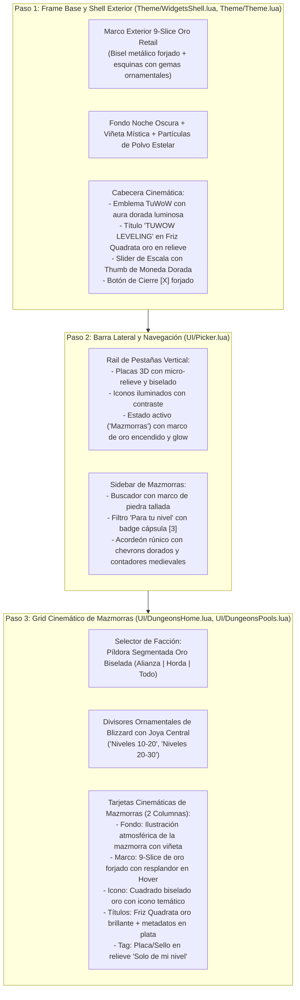

# Plan de Rediseño Cinemático UI/UX: `TuWoW Leveling`
## Estilo WoW Retail (Dragonflight / The War Within / Midnight) para TuWoW 3.3.5a

> [!IMPORTANT]
> **Objetivo:** Transformar la interfaz visual de `TuWoW Leveling` de una apariencia plana y minimalista a una experiencia moderna, inmersiva, cinematográfica y rica en texturas de fantasía oscura y oro envejecido, inspirada fielmente en la interfaz moderna de World of Warcraft Retail y en la identidad visual de TuWoW.
> **Regla de Oro:** Se rediseña estrictamente la capa visual (Frames, Texturas, Backdrops, Capas ARTWORK/OVERLAY, Animaciones de Brillo). **La lógica de datos del addon permanece 100% intacta y todos los archivos deben mantenerse por debajo de las 1000 líneas**.

---

## 1. Arquitectura Visual y Distribución de Capas

---

## 2. Fases de Implementación

### Paso 1: Shell Exterior, Fondo Profundo y Cabecera Cinemática
* **Archivos:** `Theme/Theme.lua`, `Theme/WidgetsShell.lua`, `Theme/SkinForever.lua`.
* **Marco 9-Slice de Oro Forjado:**
  - Sustituir el marco liso por un borde 9-slice compuesto por esquinas con gemas ornamentales y molduras biseladas en oro envejecido (`Interface\\DialogFrame\\UI-DialogBox-Gold-Border` o texturas atlas ForeverUI).
* **Fondo y Viñeta:**
  - Fondo base azul noche pizarra (`#070a12`) con gradiente radial y textura de pergamino oscuro cósmico.
* **Cabecera y Controles:**
  - Emblema con halo de brillo perimetral en capa `BACKGROUND`.
  - Tipografía `Friz Quadrata` en relieve con sombra profunda y color oro (`#FFD100` / `#FFE875`).
  - Slider de `"Escala de los menús"` con thumb en forma de moneda/gema dorada de WoW (`UI-Gold-Coin` o `minimal_sliderbar_button`).
  - Botón de cierre `[X]` metálico con esquinas ingletadas y cruz roja de alto contraste.

---

### Paso 2: Barra Lateral (Rail) y Navegación de Categorías
* **Archivos:** `UI/Picker.lua`, `Theme/WidgetsControls.lua`.
* **Botones del Rail:**
  - Cada pestaña (Guías, Buscador, Mazmorras, Raros, Opciones) utiliza una placa 3D con textura de metal pulido y micro-relieve.
  - El botón seleccionado (ej. Mazmorras) despliega un marco dorado encendido, fondo azul zafiro oscuro y texto iluminado.
* **Sidebar de Mazmorras:**
  - Caja de búsqueda con textura de piedra tallada y marco dorado tenue.
  - Filtro `"Para tu nivel"` con badge circular/cápsula medieval que destaca el número en azul/oro.
  - Menú colapsable con chevrons dorados y contadores numéricos encapsulados en burbujas con reborde dorado.

---

### Paso 3: Grid Cinemático de Tarjetas de Mazmorras
* **Archivos:** `UI/DungeonsHome.lua`, `UI/DungeonsPools.lua`.
* **Dungeon Cards (Formato 2 Columnas Panorámico):**
  - **Fondo de Mazmorra:** Arte oficial oscuro y difuminado con viñeta para cada mazmorra (Ragefire Chasm, Deadmines, Wailing Caverns, Shadowfang Keep, Blackfathom Deeps, Stormwind Stockade, etc.).
  - **Borde de Tarjeta:** Marco dorado de fantasía con esquinas forjadas y resplandor dinámico (*hover glow*) al pasar el cursor.
  - **Icono:** Enmarcado en cuadrado dorado biselado a la izquierda.
  - **Textos:** Título en `Friz Quadrata` dorado brillante, iconos de pergamino y datos de nivel/zona/misiones en plata clara (`#E0E0E0`).
  - **Sello de Nivel ("Solo de mi nivel"):** Chapa/placa de bronce y oro con texto en relieve e iluminación interior.
* **Divisores de Sección:**
  - Barras ornamentales con filigrana dorada y joya central en cada rango de nivel (`Niveles 10-20`, `Niveles 20-30`).
* **Selector de Facción:**
  - Cápsula dorada triple biselada (`[ Alianza | Horda | Todo ]`).

---

## 3. Garantías Técnicas
1. **Compatibilidad Nativa WotLK 3.3.5a:** Uso exclusivo de capas nativas (`BACKGROUND`, `BORDER`, `ARTWORK`, `OVERLAY`), metatablas y texturas nativas del motor 3.3.5a.
2. **Autosuficiencia:** Cero dependencias de otros addons. Todos los assets requeridos residen dentro de `TuWoW_Leveling/Assets/` o de los archivos de FrameXML del juego.
3. **Control de Líneas:** Ningún archivo superará el límite de las 1000 líneas.

